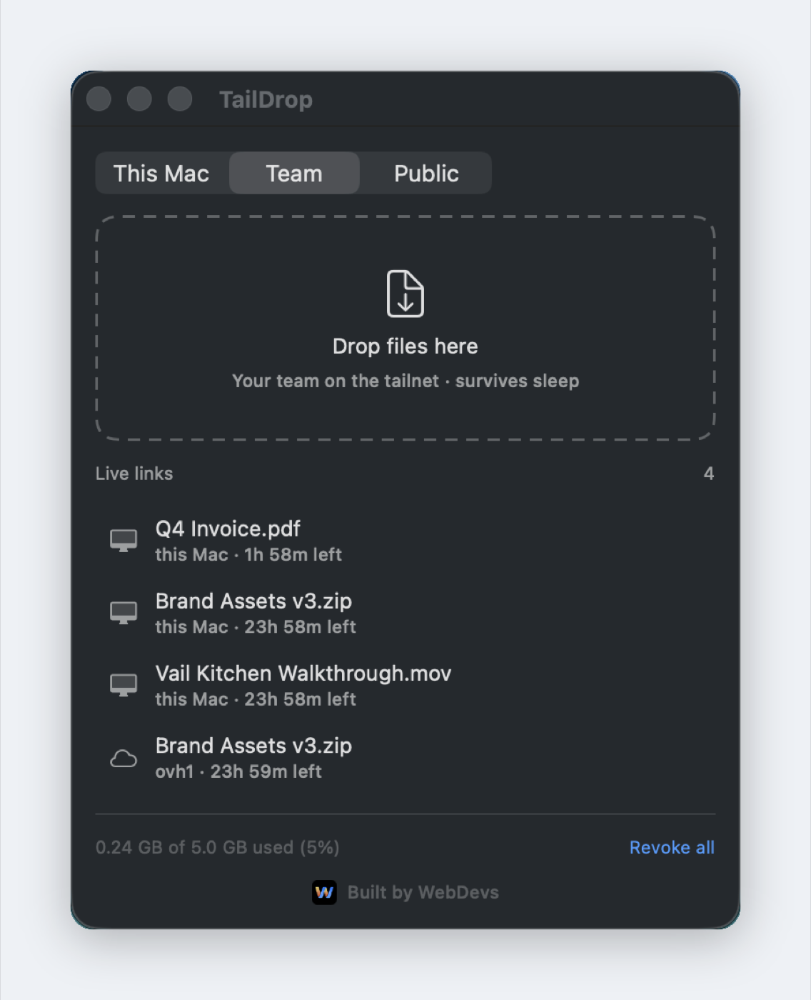
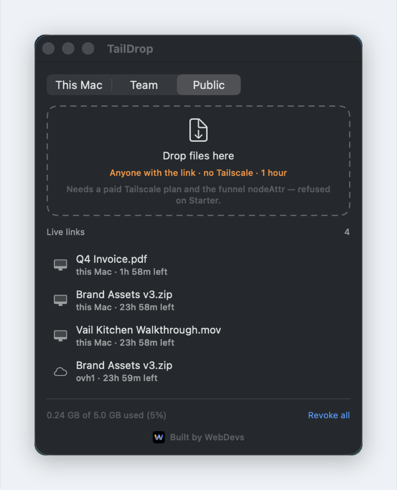

<div align="center">
  
  <h1>TailDrop</h1>
  <p><strong>Send big files to your tailnet in one drag.</strong><br>
  No upload to a cloud you don't own. No 25 MB attachment limit. No "I'll WeTransfer it over."</p>
</div>

<p align="center">
  
</p>

Drag a file onto TailDrop. You get a link back, already on your clipboard. Anyone on your tailnet
opens it and the download starts — at whatever speed your Tailscale connection runs, straight from
the machine holding the file.

A 4 GB video goes out as easily as a 40 KB PDF: nothing is re-encoded, nothing is staged through
anyone else's service, and nothing counts against a quota.

## Why it exists

Sharing a large file with your own team is stupidly hard. Email bounces it. Slack compresses it or
refuses it. Drive wants everyone signed into the right account. A USB stick means someone walks.
Meanwhile you already have a private network with every machine and teammate on it — the file could
simply move.

That is the whole idea: **your tailnet is already the file-sharing network.** TailDrop is the
plumbing that turns it into a link.

## Three levels of reach

Pick how far each file travels. The tab you choose decides who can open the link.

| | **This Mac** | **Team** | **Public** |
|---|---|---|---|
| Who can open it | your own devices | anyone on your tailnet | anyone with the link |
| Upload | none — stays put | to your server | to your server |
| Works while the Mac sleeps | no | yes | yes |
| Link expires | 24 h | 24 h | 1 h |

**This Mac** is the fastest path: the file never moves, and the link serves straight off your disk.
Ideal for a teammate on the same tailnet while your Mac is awake.

**Team** copies the file to a Linux node you own and serves it from there, so the link keeps working
after your laptop closes. This is also the one that reaches people whose ACL doesn't admit them to
your Mac — most tailnets are stricter than their owners remember. `tnshare doctor` prints exactly
who is on each side.

**Public** leaves the tailnet entirely, through Tailscale Funnel: a link you can send to a client or
a contractor with no Tailscale at their end.

<p align="center">
  
</p>

> **Public needs a paid Tailscale plan.** Funnel is not available on Starter, and it also needs the
> `funnel` nodeAttr granted to the serving node. TailDrop verifies both and refuses clearly, rather
> than handing you a link that quietly 404s.

## Built for not leaving a mess

- **Links expire by themselves.** 24 hours by default, one hour for public. No cleanup chore, no
  files living forever on a server you forgot about.
- **The store is capped at 5 GB.** Past the ceiling, the oldest shares are revoked to make room and
  TailDrop says which ones went.
- **Nothing is really copied.** On APFS the local store uses copy-on-write clones: instant, and
  near-zero disk until the original changes.
- **One file per link.** The token URL points at the file itself, so there is no directory to browse
  and no walking from one share to another.
- **Revoke anything, anytime.** One click in the app, or `tnshare stop-all`.

## Three ways to use it

**The app** — a small floating window. Drag files in, see what's live, copy or revoke with a click.

**Finder** — right-click any file → Quick Actions → Send with TailDrop. The link lands on your
clipboard and a notification confirms it.

**The terminal**

```bash
tnshare add ~/big.mov             # your own devices
tnshare hosted ~/big.mov          # the whole tailnet
tnshare public ~/big.mov          # anyone with the link
tnshare list                      # what's live, and for how long
tnshare doctor                    # who can actually reach your links
tnshare stop-all                  # revoke everything
```

## Install

```bash
git clone https://github.com/webdevs-net/taildrop.git && cd taildrop
./install.sh            # CLI, background service, Finder Quick Actions
app/build-app.sh        # builds app/build/TailDrop.app
```

For **Team** and **Public** sharing, point it at a Linux node you can reach over SSH:

```bash
mkdir -p ~/.config/taildrop && cp config.example ~/.config/taildrop/config
chmod 600 ~/.config/taildrop/config && $EDITOR ~/.config/taildrop/config
```

That server runs a dedicated, unprivileged `taildrop` account which owns one directory and may run
exactly one command as root. Setup is at the bottom of this file.

## How it actually works

Tailscale's macOS build can't serve files from disk — the app sandbox blocks
`tailscale serve --set-path`. So local shares take a different route:

1. A background service runs a small HTTP server on `127.0.0.1:8731`, reachable from nowhere else.
2. `tailscale serve` publishes it at `https://<your-mac>.<tailnet>.ts.net:8443/` — tailnet-only,
   with a real TLS certificate.
3. Each share gets a random 96-bit token. The file is cloned into the store first, which also keeps
   the service out of TCC-protected folders like Desktop and Documents that a background agent
   cannot read.

Hosted and public shares skip all that: the file goes to your Linux node, which runs real
`tailscaled` and can publish a path directly, with a systemd timer to delete it at expiry.

Unknown and expired tokens 404. Path traversal is rejected. `Range` requests work, so a 4 GB
download resumes after a dropped connection instead of starting over.

### Hosted server setup

```bash
scp server/tnshare-host root@yourserver:/usr/local/bin/tnshare-host
```

```bash
ssh root@yourserver 'bash -s' <<'EOF'
useradd --system --home-dir /srv/drop --shell /bin/bash taildrop
mkdir -p /srv/drop/shares /srv/drop/.ssh && chmod 700 /srv/drop/.ssh
chown -R taildrop:taildrop /srv/drop/shares /srv/drop/.ssh
printf 'taildrop ALL=(root) NOPASSWD: /usr/local/bin/tnshare-host\n' > /etc/sudoers.d/taildrop
chmod 440 /etc/sudoers.d/taildrop && visudo -c -f /etc/sudoers.d/taildrop
EOF
```

Add your public key to `/srv/drop/.ssh/authorized_keys` prefixed with `restrict,pty`, so it cannot
forward ports or open tunnels.

## Configuration

| Variable | Default |
|---|---|
| `TNSHARE_TTL` | `86400` (24 h) |
| `TNSHARE_PUBLIC_TTL` | `3600` (1 h) |
| `TNSHARE_MAX_BYTES` | `5368709120` (5 GiB) |
| `TNSHARE_PORT` | `8731` (local HTTP) |
| `TNSHARE_HTTPS_PORT` | `8443` (Serve) |
| `TAILDROP_HOST_SSH` | your server's SSH target |
| `TAILDROP_HOST_KEY` | `~/.ssh/taildrop_ed25519` |

## Requirements

macOS 14+, Tailscale, and — for Team and Public — a Linux node on your tailnet. Public additionally
needs a paid Tailscale plan.

---

<div align="center">
  <sub>Built by <a href="https://webdevs.net">WebDevs</a></sub>
</div>
